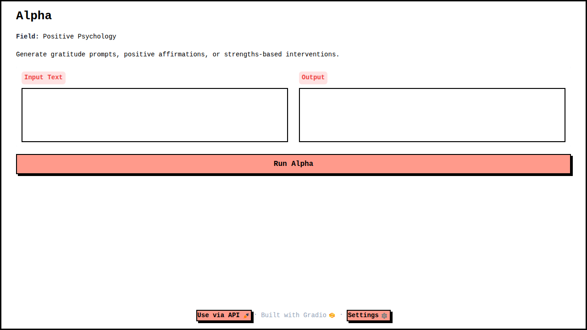
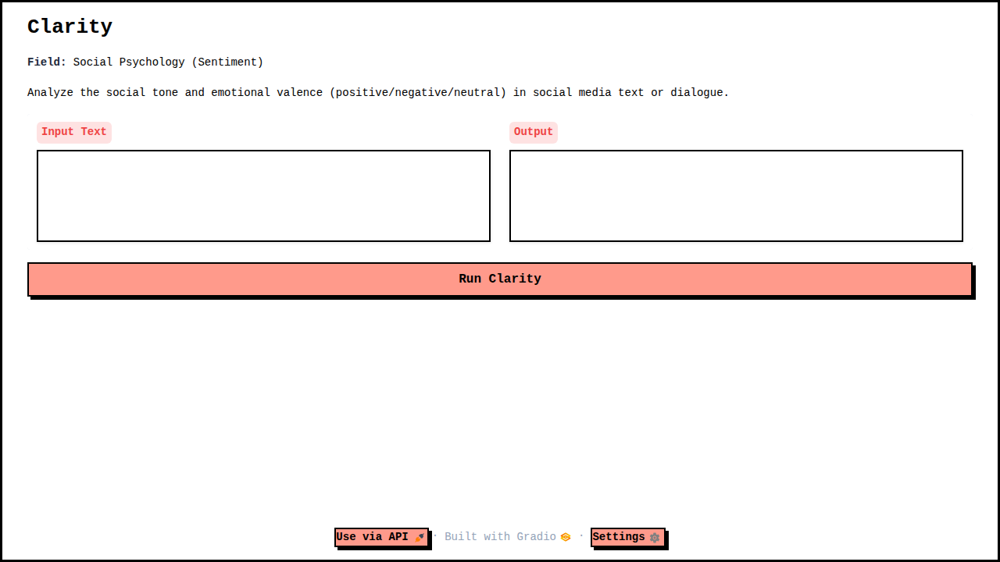
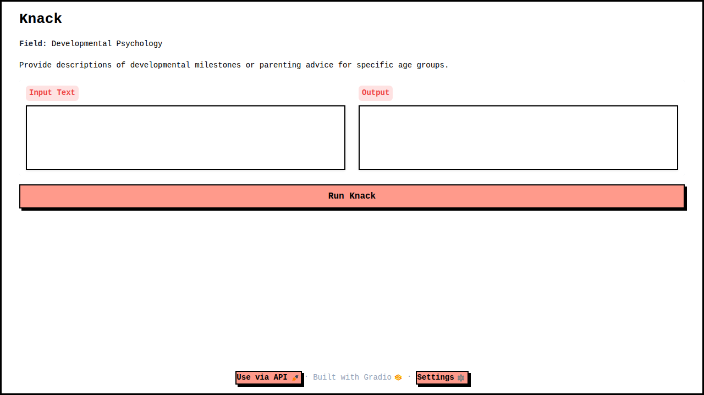
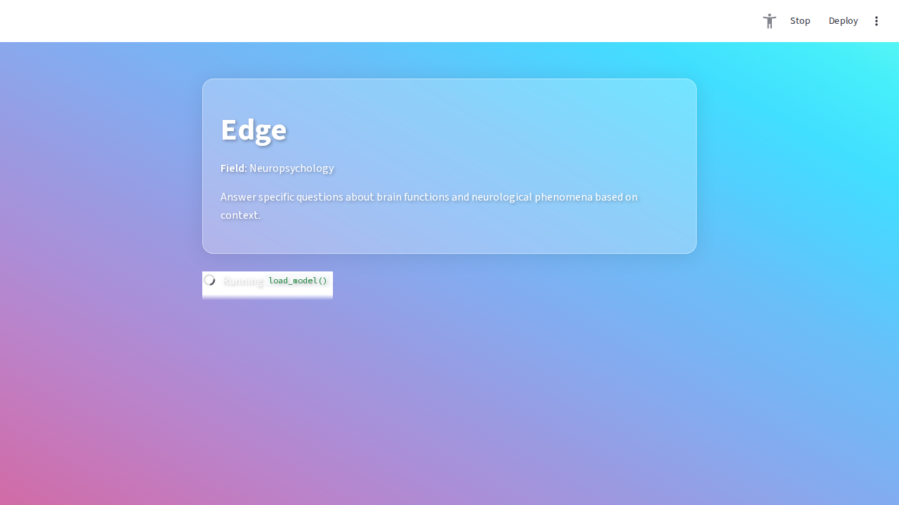
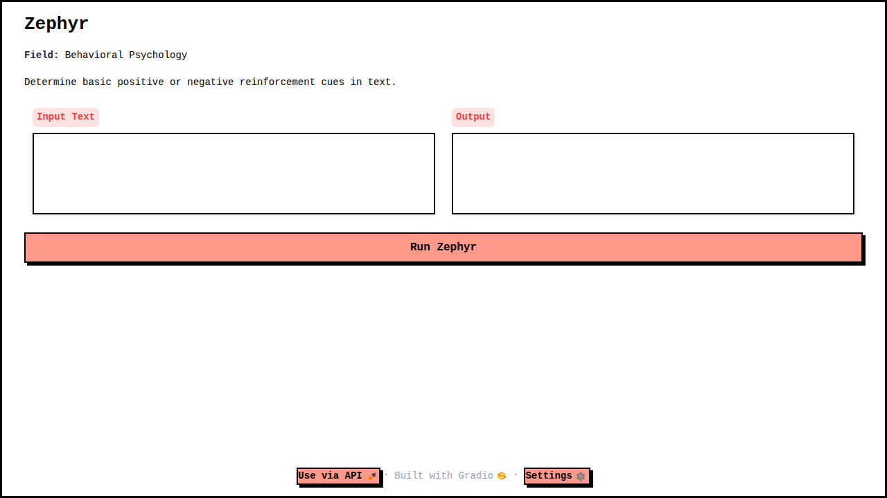

# Psychology Inference Tools User Manual

## Introduction
This manual provides a comprehensive guide to the AI-powered psychology inference tools generated in this repository. Each tool is designed for a specific domain within psychology, leveraging state-of-the-art NLP models to assist researchers, students, and practitioners.

## General Usage
- **Streamlit Tools:** Run with `streamlit run <tool_name>.py`. Access at `http://localhost:8501`.
- **Gradio Tools:** Run with `python <tool_name>.py`. Access at `http://localhost:7860`.

---

# Tools Catalog

## Aether_Streamlit
**Field:** Rehabilitation Psychology

**File:** `psychology_inference_tools/Aether_Streamlit.py`

---

## Alpha_Gradio
**Field:** Positive Psychology

**File:** `psychology_inference_tools/Alpha_Gradio.py`

---

## Apex_Gradio
**Field:** Social Psychology (Sentiment)

**File:** `psychology_inference_tools/Apex_Gradio.py`

---

## Arcane_Gradio
**Field:** Clinical Psychology

**File:** `psychology_inference_tools/Arcane_Gradio.py`

---

## Aura_Streamlit
**Field:** Educational Psychology

**File:** `psychology_inference_tools/Aura_Streamlit.py`

---

## Axis_Gradio
**Field:** Educational Psychology

**File:** `psychology_inference_tools/Axis_Gradio.py`

---

## Azure_Gradio
**Field:** Forensic Psychology

**File:** `psychology_inference_tools/Azure_Gradio.py`

---

## Beacon_Gradio
**Field:** Comparative Psychology

**File:** `psychology_inference_tools/Beacon_Gradio.py`

---

## Beta_Streamlit
**Field:** Cyberpsychology

**File:** `psychology_inference_tools/Beta_Streamlit.py`

---

## Brave_Gradio
**Field:** Biopsychology

**File:** `psychology_inference_tools/Brave_Gradio.py`

---

## Civic_Gradio
**Field:** Neuropsychology

**File:** `psychology_inference_tools/Civic_Gradio.py`

---

## Clarity_Gradio
**Field:** Social Psychology (Sentiment)

**File:** `psychology_inference_tools/Clarity_Gradio.py`

---

## Coral_Streamlit
**Field:** Social Psychology (Emotion)

**File:** `psychology_inference_tools/Coral_Streamlit.py`

---

## Core_Gradio
**Field:** Health Psychology

**File:** `psychology_inference_tools/Core_Gradio.py`

---

## Crisp_Streamlit
**Field:** Crisis Intervention

**File:** `psychology_inference_tools/Crisp_Streamlit.py`

---

## Dash_Gradio
**Field:** Cross-Cultural Psychology

**File:** `psychology_inference_tools/Dash_Gradio.py`

---

## Delta_Gradio
**Field:** Rehabilitation Psychology

**File:** `psychology_inference_tools/Delta_Gradio.py`

---

## Drift_Gradio
**Field:** Behavioral Psychology

**File:** `psychology_inference_tools/Drift_Gradio.py`

---

## Drive_Gradio
**Field:** Sleep Psychology

**File:** `psychology_inference_tools/Drive_Gradio.py`

---

## Echo_Streamlit
**Field:** Developmental Psychology

**File:** `psychology_inference_tools/Echo_Streamlit.py`

---

## Edge_Streamlit
**Field:** Neuropsychology

**File:** `psychology_inference_tools/Edge_Streamlit.py`

---

## Elan_Gradio
**Field:** Biopsychology

**File:** `psychology_inference_tools/Elan_Gradio.py`

---

## Ember_Gradio
**Field:** Developmental Psychology

**File:** `psychology_inference_tools/Ember_Gradio.py`

---

## Epsilon_Streamlit
**Field:** Cross-Cultural Psychology

**File:** `psychology_inference_tools/Epsilon_Streamlit.py`

---

## Essence_Gradio
**Field:** Sports Psychology

**File:** `psychology_inference_tools/Essence_Gradio.py`

---

## Eta_Streamlit
**Field:** Social Psychology (Emotion)

**File:** `psychology_inference_tools/Eta_Streamlit.py`

---

## Ethos_Streamlit
**Field:** Crisis Intervention

**File:** `psychology_inference_tools/Ethos_Streamlit.py`

---

## Fern_Gradio
**Field:** Social Psychology (Complex Emotions)

**File:** `psychology_inference_tools/Fern_Gradio.py`

---

## Focus_Streamlit
**Field:** Media Psychology

**File:** `psychology_inference_tools/Focus_Streamlit.py`

---

## Forge_Streamlit
**Field:** Industrial-Organizational Psychology

**File:** `psychology_inference_tools/Forge_Streamlit.py`

---

## Gamma_Gradio
**Field:** Social Psychology (Sentiment)

**File:** `psychology_inference_tools/Gamma_Gradio.py`

---

## Garnet_Streamlit
**Field:** Industrial-Organizational Psychology

**File:** `psychology_inference_tools/Garnet_Streamlit.py`

---

## Gaze_Gradio
**Field:** Sound Therapy

**File:** `psychology_inference_tools/Gaze_Gradio.py`

---

## Glee_Streamlit
**Field:** Social Psychology (Sentiment)

**File:** `psychology_inference_tools/Glee_Streamlit.py`

---

## Glint_Streamlit
**Field:** Positive Psychology

**File:** `psychology_inference_tools/Glint_Streamlit.py`

---

## Grace_Streamlit
**Field:** Health Psychology

**File:** `psychology_inference_tools/Grace_Streamlit.py`

---

## Haptic_Gradio
**Field:** Consumer Psychology

**File:** `psychology_inference_tools/Haptic_Gradio.py`

---

## Helm_Streamlit
**Field:** Behavioral Psychology

**File:** `psychology_inference_tools/Helm_Streamlit.py`

---

## Hush_Streamlit
**Field:** Cognitive Psychology

**File:** `psychology_inference_tools/Hush_Streamlit.py`

---

## Icon_Streamlit
**Field:** Psychometrics

**File:** `psychology_inference_tools/Icon_Streamlit.py`

---

## Insight_Gradio
**Field:** Neuropsychology

**File:** `psychology_inference_tools/Insight_Gradio.py`

---

## Ionic_Gradio
**Field:** Behavioral Psychology

**File:** `psychology_inference_tools/Ionic_Gradio.py`

---

## Iota_Streamlit
**Field:** Sports Psychology

**File:** `psychology_inference_tools/Iota_Streamlit.py`

---

## Iris_Streamlit
**Field:** Evolutionary Psychology

**File:** `psychology_inference_tools/Iris_Streamlit.py`

---

## Jade_Gradio
**Field:** Social Psychology (Complex Emotions)

**File:** `psychology_inference_tools/Jade_Gradio.py`

---

## Kairos_Streamlit
**Field:** Behavioral Psychology

**File:** `psychology_inference_tools/Kairos_Streamlit.py`

---

## Keen_Streamlit
**Field:** Forensic Psychology

**File:** `psychology_inference_tools/Keen_Streamlit.py`

---

## Kinetic_Streamlit
**Field:** Sleep Psychology

**File:** `psychology_inference_tools/Kinetic_Streamlit.py`

---

## Knack_Gradio
**Field:** Developmental Psychology

**File:** `psychology_inference_tools/Knack_Gradio.py`

---

## Lambda_Streamlit
**Field:** Comparative Psychology

**File:** `psychology_inference_tools/Lambda_Streamlit.py`

---

## Lens_Streamlit
**Field:** Developmental Psychology

**File:** `psychology_inference_tools/Lens_Streamlit.py`

---

## Lime_Gradio
**Field:** Geropsychology

**File:** `psychology_inference_tools/Lime_Gradio.py`

---

## Logic_Gradio
**Field:** Rehabilitation Psychology

**File:** `psychology_inference_tools/Logic_Gradio.py`

---

## Lotus_Streamlit
**Field:** Psychometrics

**File:** `psychology_inference_tools/Lotus_Streamlit.py`

---

## Lumen_Streamlit
**Field:** Geropsychology

**File:** `psychology_inference_tools/Lumen_Streamlit.py`

---

## Lush_Gradio
**Field:** Cyberpsychology

**File:** `psychology_inference_tools/Lush_Gradio.py`

---

## Matrix_Streamlit
**Field:** Cognitive Psychology

**File:** `psychology_inference_tools/Matrix_Streamlit.py`

---

## Maze_Streamlit
**Field:** Developmental Psychology

**File:** `psychology_inference_tools/Maze_Streamlit.py`

---

## Mode_Streamlit
**Field:** Cognitive Psychology

**File:** `psychology_inference_tools/Mode_Streamlit.py`

---

## Momentum_Streamlit
**Field:** Social Psychology (Emotion)

**File:** `psychology_inference_tools/Momentum_Streamlit.py`

---

## Mosaic_Streamlit
**Field:** Cross-Cultural Psychology

**File:** `psychology_inference_tools/Mosaic_Streamlit.py`

---

## Moss_Gradio
**Field:** Consumer Psychology

**File:** `psychology_inference_tools/Moss_Gradio.py`

---

## Mu_Gradio
**Field:** Biopsychology

**File:** `psychology_inference_tools/Mu_Gradio.py`

---

## Myriad_Streamlit
**Field:** Environmental Psychology

**File:** `psychology_inference_tools/Myriad_Streamlit.py`

---

## Mythic_Streamlit
**Field:** Clinical Psychology

**File:** `psychology_inference_tools/Mythic_Streamlit.py`

---

## Neon_Gradio
**Field:** Social Psychology (Emotion)

**File:** `psychology_inference_tools/Neon_Gradio.py`

---

## Nexus_Gradio
**Field:** Evolutionary Psychology

**File:** `psychology_inference_tools/Nexus_Gradio.py`

---

## Nook_Streamlit
**Field:** Sports Psychology

**File:** `psychology_inference_tools/Nook_Streamlit.py`

---

## Nova_Gradio
**Field:** Family Psychology

**File:** `psychology_inference_tools/Nova_Gradio.py`

---

## Omen_Gradio
**Field:** Family Psychology

**File:** `psychology_inference_tools/Omen_Gradio.py`

---

## Optic_Gradio
**Field:** Environmental Psychology

**File:** `psychology_inference_tools/Optic_Gradio.py`

---

## Oracle_Gradio
**Field:** Social Psychology (Complex Emotions)

**File:** `psychology_inference_tools/Oracle_Gradio.py`

---

## Origin_Streamlit
**Field:** Forensic Psychology

**File:** `psychology_inference_tools/Origin_Streamlit.py`

---

## Pace_Gradio
**Field:** Industrial-Organizational Psychology

**File:** `psychology_inference_tools/Pace_Gradio.py`

---

## Path_Gradio
**Field:** Rehabilitation Psychology

**File:** `psychology_inference_tools/Path_Gradio.py`

---

## Pave_Streamlit
**Field:** Family Psychology

**File:** `psychology_inference_tools/Pave_Streamlit.py`

---

## Peak_Streamlit
**Field:** Psychometrics

**File:** `psychology_inference_tools/Peak_Streamlit.py`

---

## Pure_Gradio
**Field:** Media Psychology

**File:** `psychology_inference_tools/Pure_Gradio.py`

---

## Quartz_Gradio
**Field:** Comparative Psychology

**File:** `psychology_inference_tools/Quartz_Gradio.py`

---

## Quiet_Streamlit
**Field:** Geropsychology

**File:** `psychology_inference_tools/Quiet_Streamlit.py`

---

## Radius_Gradio
**Field:** Educational Psychology

**File:** `psychology_inference_tools/Radius_Gradio.py`

---

## Rave_Gradio
**Field:** Sleep Psychology

**File:** `psychology_inference_tools/Rave_Gradio.py`

---

## Realm_Streamlit
**Field:** Comparative Psychology

**File:** `psychology_inference_tools/Realm_Streamlit.py`

---

## Rhythm_Streamlit
**Field:** Clinical Psychology

**File:** `psychology_inference_tools/Rhythm_Streamlit.py`

---

## Rift_Gradio
**Field:** Psychometrics

**File:** `psychology_inference_tools/Rift_Gradio.py`

---

## Ripple_Gradio
**Field:** Sleep Psychology

**File:** `psychology_inference_tools/Ripple_Gradio.py`

---

## Root_Gradio
**Field:** Neuropsychology

**File:** `psychology_inference_tools/Root_Gradio.py`

---

## Ruby_Streamlit
**Field:** Environmental Psychology

**File:** `psychology_inference_tools/Ruby_Streamlit.py`

---

## Sage_Gradio
**Field:** Social Psychology (Sentiment)

**File:** `psychology_inference_tools/Sage_Gradio.py`

---

## Scope_Gradio
**Field:** Cyberpsychology

**File:** `psychology_inference_tools/Scope_Gradio.py`

---

## Sense_Streamlit
**Field:** Health Psychology

**File:** `psychology_inference_tools/Sense_Streamlit.py`

---

## Soar_Streamlit
**Field:** Health Psychology

**File:** `psychology_inference_tools/Soar_Streamlit.py`

---

## Sonic_Streamlit
**Field:** Educational Psychology

**File:** `psychology_inference_tools/Sonic_Streamlit.py`

---

## Spark_Streamlit
**Field:** Social Psychology (Complex Emotions)

**File:** `psychology_inference_tools/Spark_Streamlit.py`

---

## Spectrum_Streamlit
**Field:** Media Psychology

**File:** `psychology_inference_tools/Spectrum_Streamlit.py`

---

## Spirit_Gradio
**Field:** Positive Psychology

**File:** `psychology_inference_tools/Spirit_Gradio.py`

---

## Surge_Gradio
**Field:** Cognitive Psychology

**File:** `psychology_inference_tools/Surge_Gradio.py`

---

## Sync_Gradio
**Field:** Clinical Psychology

**File:** `psychology_inference_tools/Sync_Gradio.py`

---

## Synergy_Streamlit
**Field:** Industrial-Organizational Psychology

**File:** `psychology_inference_tools/Synergy_Streamlit.py`

---

## Synthesis_Streamlit
**Field:** Crisis Intervention

**File:** `psychology_inference_tools/Synthesis_Streamlit.py`

---

## Tact_Streamlit
**Field:** Clinical Psychology

**File:** `psychology_inference_tools/Tact_Streamlit.py`

---

## Teal_Streamlit
**Field:** Evolutionary Psychology

**File:** `psychology_inference_tools/Teal_Streamlit.py`

---

## Tempo_Streamlit
**Field:** Social Psychology (Emotion)

**File:** `psychology_inference_tools/Tempo_Streamlit.py`

---

## Terra_Streamlit
**Field:** Cognitive Psychology

**File:** `psychology_inference_tools/Terra_Streamlit.py`

---

## Theta_Gradio
**Field:** Positive Psychology

**File:** `psychology_inference_tools/Theta_Gradio.py`

---

## Tide_Gradio
**Field:** Family Psychology

**File:** `psychology_inference_tools/Tide_Gradio.py`

---

## Tonic_Gradio
**Field:** Geropsychology

**File:** `psychology_inference_tools/Tonic_Gradio.py`

---

## Topaz_Streamlit
**Field:** Evolutionary Psychology

**File:** `psychology_inference_tools/Topaz_Streamlit.py`

---

## Trace_Gradio
**Field:** Forensic Psychology

**File:** `psychology_inference_tools/Trace_Gradio.py`

---

## Umbra_Streamlit
**Field:** Crisis Intervention

**File:** `psychology_inference_tools/Umbra_Streamlit.py`

---

## Vale_Streamlit
**Field:** Social Psychology (Complex Emotions)

**File:** `psychology_inference_tools/Vale_Streamlit.py`

---

## Valence_Gradio
**Field:** Industrial-Organizational Psychology

**File:** `psychology_inference_tools/Valence_Gradio.py`

---

## Vector_Gradio
**Field:** Forensic Psychology

**File:** `psychology_inference_tools/Vector_Gradio.py`

---

## Vigil_Streamlit
**Field:** Consumer Psychology

**File:** `psychology_inference_tools/Vigil_Streamlit.py`

---

## Vivid_Streamlit
**Field:** Sports Psychology

**File:** `psychology_inference_tools/Vivid_Streamlit.py`

---

## Weave_Streamlit
**Field:** Environmental Psychology

**File:** `psychology_inference_tools/Weave_Streamlit.py`

---

## Will_Gradio
**Field:** Consumer Psychology

**File:** `psychology_inference_tools/Will_Gradio.py`

---

## Wisp_Gradio
**Field:** Sound Therapy

**File:** `psychology_inference_tools/Wisp_Gradio.py`

---

## Yonder_Gradio
**Field:** Sound Therapy

**File:** `psychology_inference_tools/Yonder_Gradio.py`

---

## Yore_Streamlit
**Field:** Cross-Cultural Psychology

**File:** `psychology_inference_tools/Yore_Streamlit.py`

---

## Zenith_Streamlit
**Field:** Biopsychology

**File:** `psychology_inference_tools/Zenith_Streamlit.py`

---

## Zephyr_Gradio
**Field:** Behavioral Psychology

**File:** `psychology_inference_tools/Zephyr_Gradio.py`

---

## Zest_Streamlit
**Field:** Sound Therapy

**File:** `psychology_inference_tools/Zest_Streamlit.py`

---

## Zeta_Gradio
**Field:** Cyberpsychology

**File:** `psychology_inference_tools/Zeta_Gradio.py`

---

## Zone_Gradio
**Field:** Media Psychology

**File:** `psychology_inference_tools/Zone_Gradio.py`

---
