# Psychology Inference Tools User Manual

## Introduction
This manual provides a comprehensive guide to the AI-powered psychology inference tools generated in this repository. Each tool is designed for a specific domain within psychology, leveraging state-of-the-art NLP models to assist researchers, students, and practitioners.

## General Usage
- **Streamlit Tools:** Run with `streamlit run <tool_name>.py`. Access at `http://localhost:8501`.
- **Gradio Tools:** Run with `python <tool_name>.py`. Access at `http://localhost:7860`.

---

# Tools Catalog

## Aether_Gradio
**Field:** Comparative Psychology

**File:** `psychology_inference_tools/Aether_Gradio.py`

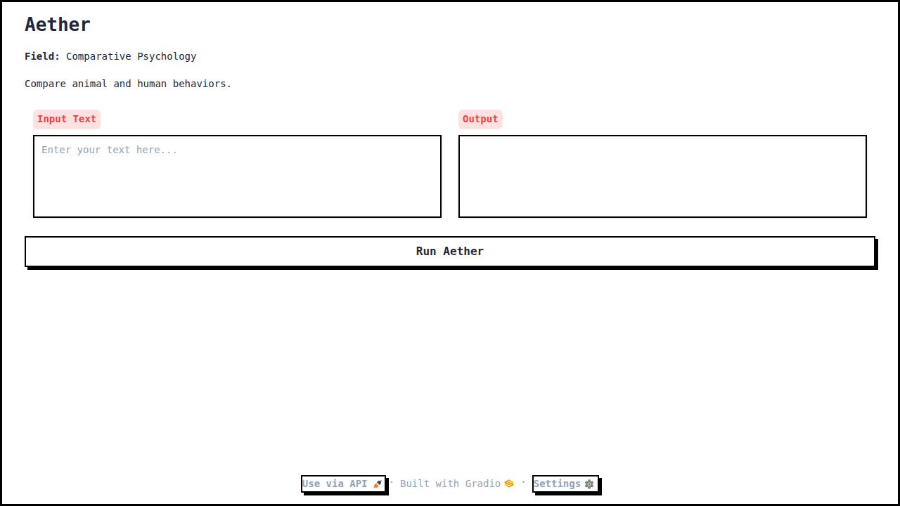

---

## Aether_Streamlit
**Field:** Cognitive Psychology

**File:** `psychology_inference_tools/Aether_Streamlit.py`

---

## Alpha_Streamlit
**Field:** Industrial-Organizational Psychology

**File:** `psychology_inference_tools/Alpha_Streamlit.py`

---

## Anima_Gradio
**Field:** Health Psychology

**File:** `psychology_inference_tools/Anima_Gradio.py`

---

## Apex_Streamlit
**Field:** Positive Psychology

**File:** `psychology_inference_tools/Apex_Streamlit.py`

---

## Aura_Gradio
**Field:** Biopsychology

**File:** `psychology_inference_tools/Aura_Gradio.py`

---

## Aura_Streamlit
**Field:** Positive Psychology

**File:** `psychology_inference_tools/Aura_Streamlit.py`

---

## Axis_Gradio
**Field:** Neuropsychology

**File:** `psychology_inference_tools/Axis_Gradio.py`

---

## Axis_Streamlit
**Field:** Biopsychology

**File:** `psychology_inference_tools/Axis_Streamlit.py`

---

## Beacon_Streamlit
**Field:** Clinical Psychology

**File:** `psychology_inference_tools/Beacon_Streamlit.py`

---

## Beta_Gradio
**Field:** Educational Psychology

**File:** `psychology_inference_tools/Beta_Gradio.py`

---

## Bridge_Gradio
**Field:** Developmental Psychology

**File:** `psychology_inference_tools/Bridge_Gradio.py`

---

## Bridge_Streamlit
**Field:** Biopsychology

**File:** `psychology_inference_tools/Bridge_Streamlit.py`

---

## Catalyst_Streamlit
**Field:** Consumer Psychology

**File:** `psychology_inference_tools/Catalyst_Streamlit.py`

---

## Civic_Gradio
**Field:** Developmental Psychology

**File:** `psychology_inference_tools/Civic_Gradio.py`

---

## Clarity_Streamlit
**Field:** Consumer Psychology

**File:** `psychology_inference_tools/Clarity_Streamlit.py`

---

## Core_Gradio
**Field:** Biopsychology

**File:** `psychology_inference_tools/Core_Gradio.py`

---

## Core_Streamlit
**Field:** Social Psychology

**File:** `psychology_inference_tools/Core_Streamlit.py`

---

## Crest_Streamlit
**Field:** Clinical Psychology

**File:** `psychology_inference_tools/Crest_Streamlit.py`

---

## Delta_Gradio
**Field:** Cross-Cultural Psychology

**File:** `psychology_inference_tools/Delta_Gradio.py`

---

## Delta_Streamlit
**Field:** Clinical Psychology

**File:** `psychology_inference_tools/Delta_Streamlit.py`

---

## Drift_Gradio
**Field:** Comparative Psychology

**File:** `psychology_inference_tools/Drift_Gradio.py`

---

## Drift_Streamlit
**Field:** Forensic Psychology

**File:** `psychology_inference_tools/Drift_Streamlit.py`

---

## Ember_Gradio
**Field:** Clinical Psychology

**File:** `psychology_inference_tools/Ember_Gradio.py`

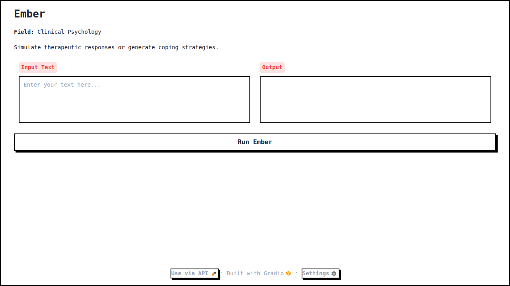

---

## Ember_Streamlit
**Field:** Comparative Psychology

**File:** `psychology_inference_tools/Ember_Streamlit.py`

---

## Epsilon_Gradio
**Field:** Educational Psychology

**File:** `psychology_inference_tools/Epsilon_Gradio.py`

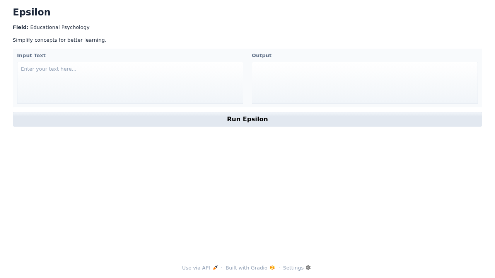

---

## Epsilon_Streamlit
**Field:** Neuropsychology

**File:** `psychology_inference_tools/Epsilon_Streamlit.py`

---

## Essence_Gradio
**Field:** Comparative Psychology

**File:** `psychology_inference_tools/Essence_Gradio.py`

---

## Essence_Streamlit
**Field:** Health Psychology

**File:** `psychology_inference_tools/Essence_Streamlit.py`

---

## Eta_Gradio
**Field:** Social Psychology

**File:** `psychology_inference_tools/Eta_Gradio.py`

---

## Eta_Streamlit
**Field:** Neuropsychology

**File:** `psychology_inference_tools/Eta_Streamlit.py`

---

## Ethic_Gradio
**Field:** Comparative Psychology

**File:** `psychology_inference_tools/Ethic_Gradio.py`

---

## Ethic_Streamlit
**Field:** Environmental Psychology

**File:** `psychology_inference_tools/Ethic_Streamlit.py`

---

## Ethos_Gradio
**Field:** Environmental Psychology

**File:** `psychology_inference_tools/Ethos_Gradio.py`

---

## Flux_Streamlit
**Field:** Environmental Psychology

**File:** `psychology_inference_tools/Flux_Streamlit.py`

---

## Focus_Streamlit
**Field:** Educational Psychology

**File:** `psychology_inference_tools/Focus_Streamlit.py`

---

## Forge_Streamlit
**Field:** Environmental Psychology

**File:** `psychology_inference_tools/Forge_Streamlit.py`

---

## Fuse_Streamlit
**Field:** Cross-Cultural Psychology

**File:** `psychology_inference_tools/Fuse_Streamlit.py`

---

## Gamma_Streamlit
**Field:** Sports Psychology

**File:** `psychology_inference_tools/Gamma_Streamlit.py`

---

## Gaze_Gradio
**Field:** Evolutionary Psychology

**File:** `psychology_inference_tools/Gaze_Gradio.py`

---

## Gaze_Streamlit
**Field:** Forensic Psychology

**File:** `psychology_inference_tools/Gaze_Streamlit.py`

---

## Glow_Gradio
**Field:** Developmental Psychology

**File:** `psychology_inference_tools/Glow_Gradio.py`

---

## Glow_Streamlit
**Field:** Biopsychology

**File:** `psychology_inference_tools/Glow_Streamlit.py`

---

## Grit_Streamlit
**Field:** Rehabilitation Psychology

**File:** `psychology_inference_tools/Grit_Streamlit.py`

---

## Grove_Streamlit
**Field:** Environmental Psychology

**File:** `psychology_inference_tools/Grove_Streamlit.py`

---

## Halo_Gradio
**Field:** Neuropsychology

**File:** `psychology_inference_tools/Halo_Gradio.py`

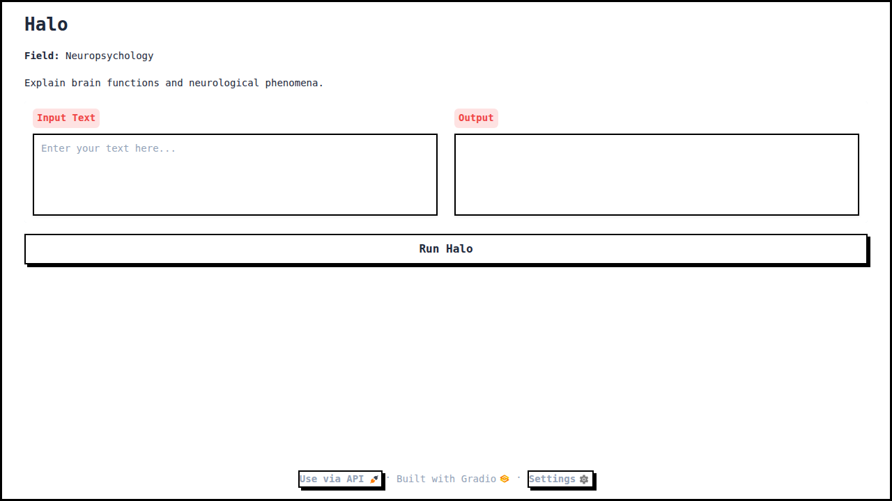

---

## Haptic_Gradio
**Field:** Biopsychology

**File:** `psychology_inference_tools/Haptic_Gradio.py`

---

## Haptic_Streamlit
**Field:** Environmental Psychology

**File:** `psychology_inference_tools/Haptic_Streamlit.py`

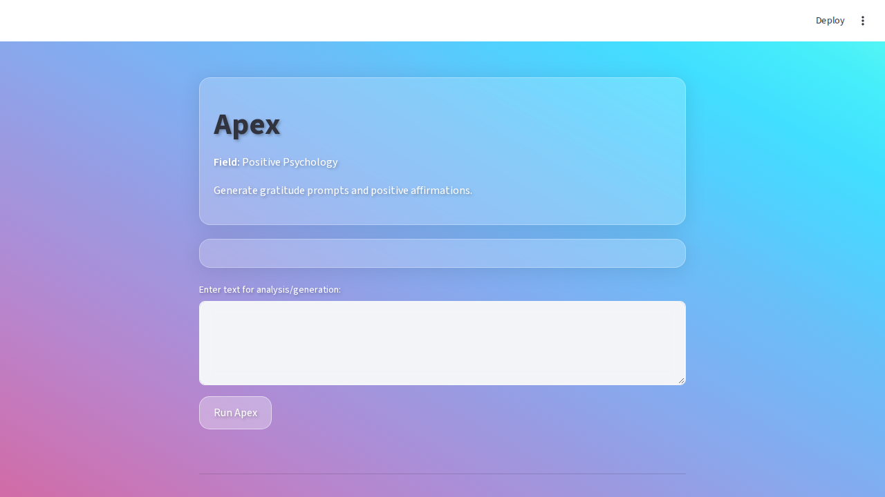

---

## Haven_Gradio
**Field:** Family Psychology

**File:** `psychology_inference_tools/Haven_Gradio.py`

---

## Haven_Streamlit
**Field:** Clinical Psychology

**File:** `psychology_inference_tools/Haven_Streamlit.py`

---

## Helm_Streamlit
**Field:** Rehabilitation Psychology

**File:** `psychology_inference_tools/Helm_Streamlit.py`

---

## Horizon_Streamlit
**Field:** Developmental Psychology

**File:** `psychology_inference_tools/Horizon_Streamlit.py`

---

## Insight_Gradio
**Field:** Neuropsychology

**File:** `psychology_inference_tools/Insight_Gradio.py`

---

## Ionic_Gradio
**Field:** Biopsychology

**File:** `psychology_inference_tools/Ionic_Gradio.py`

---

## Ionic_Streamlit
**Field:** Cognitive Psychology

**File:** `psychology_inference_tools/Ionic_Streamlit.py`

---

## Iota_Gradio
**Field:** Sports Psychology

**File:** `psychology_inference_tools/Iota_Gradio.py`

---

## Iota_Streamlit
**Field:** Rehabilitation Psychology

**File:** `psychology_inference_tools/Iota_Streamlit.py`

---

## Iris_Gradio
**Field:** Health Psychology

**File:** `psychology_inference_tools/Iris_Gradio.py`

---

## Iris_Streamlit
**Field:** Comparative Psychology

**File:** `psychology_inference_tools/Iris_Streamlit.py`

---

## Journey_Streamlit
**Field:** Neuropsychology

**File:** `psychology_inference_tools/Journey_Streamlit.py`

---

## Kairos_Gradio
**Field:** Industrial-Organizational Psychology

**File:** `psychology_inference_tools/Kairos_Gradio.py`

---

## Kappa_Streamlit
**Field:** Social Psychology

**File:** `psychology_inference_tools/Kappa_Streamlit.py`

---

## Kinetic_Streamlit
**Field:** Cross-Cultural Psychology

**File:** `psychology_inference_tools/Kinetic_Streamlit.py`

---

## Lambda_Streamlit
**Field:** Neuropsychology

**File:** `psychology_inference_tools/Lambda_Streamlit.py`

---

## Lens_Gradio
**Field:** Developmental Psychology

**File:** `psychology_inference_tools/Lens_Gradio.py`

---

## Lens_Streamlit
**Field:** Developmental Psychology

**File:** `psychology_inference_tools/Lens_Streamlit.py`

---

## Link_Gradio
**Field:** Positive Psychology

**File:** `psychology_inference_tools/Link_Gradio.py`

---

## Link_Streamlit
**Field:** Rehabilitation Psychology

**File:** `psychology_inference_tools/Link_Streamlit.py`

---

## Logic_Streamlit
**Field:** Environmental Psychology

**File:** `psychology_inference_tools/Logic_Streamlit.py`

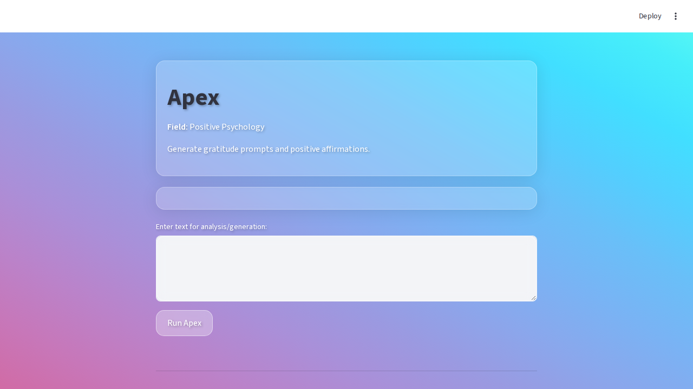

---

## Lotus_Gradio
**Field:** Social Psychology

**File:** `psychology_inference_tools/Lotus_Gradio.py`

---

## Lotus_Streamlit
**Field:** Sports Psychology

**File:** `psychology_inference_tools/Lotus_Streamlit.py`

---

## Lumen_Streamlit
**Field:** Positive Psychology

**File:** `psychology_inference_tools/Lumen_Streamlit.py`

---

## Lyric_Gradio
**Field:** Cross-Cultural Psychology

**File:** `psychology_inference_tools/Lyric_Gradio.py`

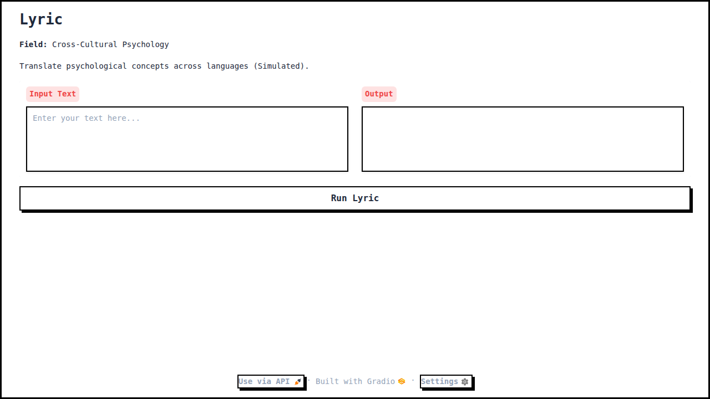

---

## Lyric_Streamlit
**Field:** Clinical Psychology

**File:** `psychology_inference_tools/Lyric_Streamlit.py`

---

## Matrix_Gradio
**Field:** Neuropsychology

**File:** `psychology_inference_tools/Matrix_Gradio.py`

---

## Matrix_Streamlit
**Field:** Educational Psychology

**File:** `psychology_inference_tools/Matrix_Streamlit.py`

---

## Merge_Gradio
**Field:** Educational Psychology

**File:** `psychology_inference_tools/Merge_Gradio.py`

---

## Merge_Streamlit
**Field:** Positive Psychology

**File:** `psychology_inference_tools/Merge_Streamlit.py`

---

## Mimesis_Gradio
**Field:** Clinical Psychology

**File:** `psychology_inference_tools/Mimesis_Gradio.py`

---

## Mimesis_Streamlit
**Field:** Cross-Cultural Psychology

**File:** `psychology_inference_tools/Mimesis_Streamlit.py`

---

## Mind_Gradio
**Field:** Evolutionary Psychology

**File:** `psychology_inference_tools/Mind_Gradio.py`

---

## Mind_Streamlit
**Field:** Social Psychology

**File:** `psychology_inference_tools/Mind_Streamlit.py`

---

## Mode_Streamlit
**Field:** Positive Psychology

**File:** `psychology_inference_tools/Mode_Streamlit.py`

---

## Momentum_Gradio
**Field:** Industrial-Organizational Psychology

**File:** `psychology_inference_tools/Momentum_Gradio.py`

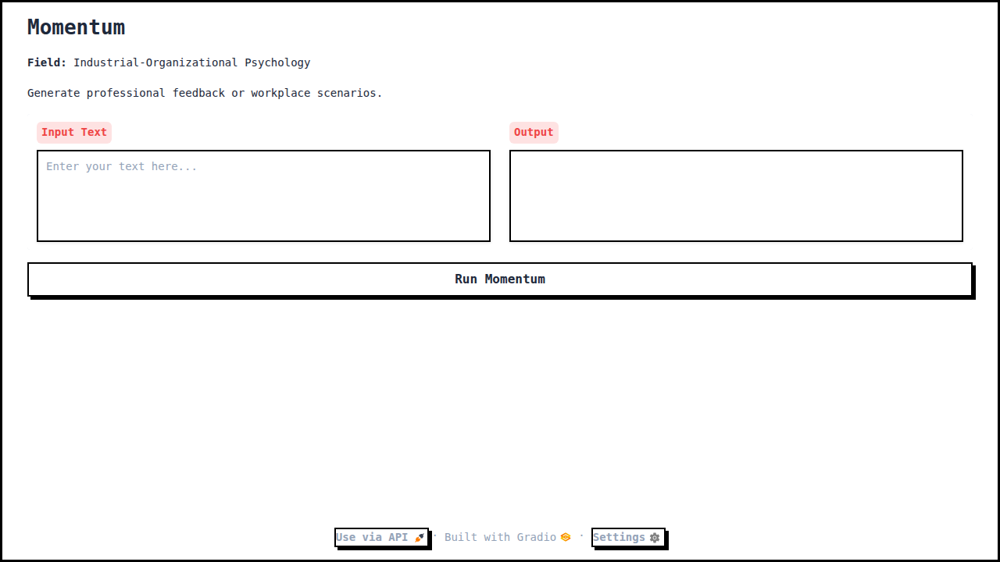

---

## Momentum_Streamlit
**Field:** Positive Psychology

**File:** `psychology_inference_tools/Momentum_Streamlit.py`

---

## Mosaic_Gradio
**Field:** Industrial-Organizational Psychology

**File:** `psychology_inference_tools/Mosaic_Gradio.py`

---

## Motion_Gradio
**Field:** Developmental Psychology

**File:** `psychology_inference_tools/Motion_Gradio.py`

---

## Motion_Streamlit
**Field:** Positive Psychology

**File:** `psychology_inference_tools/Motion_Streamlit.py`

---

## Mu_Streamlit
**Field:** Evolutionary Psychology

**File:** `psychology_inference_tools/Mu_Streamlit.py`

---

## Myriad_Gradio
**Field:** Biopsychology

**File:** `psychology_inference_tools/Myriad_Gradio.py`

---

## Myriad_Streamlit
**Field:** Sports Psychology

**File:** `psychology_inference_tools/Myriad_Streamlit.py`

---

## Mythic_Gradio
**Field:** Developmental Psychology

**File:** `psychology_inference_tools/Mythic_Gradio.py`

---

## Mythic_Streamlit
**Field:** Biopsychology

**File:** `psychology_inference_tools/Mythic_Streamlit.py`

---

## Nexus_Gradio
**Field:** Industrial-Organizational Psychology

**File:** `psychology_inference_tools/Nexus_Gradio.py`

---

## Nexus_Streamlit
**Field:** Forensic Psychology

**File:** `psychology_inference_tools/Nexus_Streamlit.py`

---

## Nova_Gradio
**Field:** Health Psychology

**File:** `psychology_inference_tools/Nova_Gradio.py`

---

## Oasis_Streamlit
**Field:** Cognitive Psychology

**File:** `psychology_inference_tools/Oasis_Streamlit.py`

---

## Omen_Streamlit
**Field:** Neuropsychology

**File:** `psychology_inference_tools/Omen_Streamlit.py`

---

## Optic_Gradio
**Field:** Family Psychology

**File:** `psychology_inference_tools/Optic_Gradio.py`

---

## Optic_Streamlit
**Field:** Cross-Cultural Psychology

**File:** `psychology_inference_tools/Optic_Streamlit.py`

---

## Oracle_Gradio
**Field:** Consumer Psychology

**File:** `psychology_inference_tools/Oracle_Gradio.py`

---

## Orbit_Gradio
**Field:** Developmental Psychology

**File:** `psychology_inference_tools/Orbit_Gradio.py`

---

## Orbit_Streamlit
**Field:** Social Psychology

**File:** `psychology_inference_tools/Orbit_Streamlit.py`

---

## Origin_Gradio
**Field:** Consumer Psychology

**File:** `psychology_inference_tools/Origin_Gradio.py`

---

## Origin_Streamlit
**Field:** Family Psychology

**File:** `psychology_inference_tools/Origin_Streamlit.py`

---

## Pace_Gradio
**Field:** Family Psychology

**File:** `psychology_inference_tools/Pace_Gradio.py`

---

## Pace_Streamlit
**Field:** Clinical Psychology

**File:** `psychology_inference_tools/Pace_Streamlit.py`

---

## Path_Streamlit
**Field:** Social Psychology

**File:** `psychology_inference_tools/Path_Streamlit.py`

---

## Peak_Streamlit
**Field:** Consumer Psychology

**File:** `psychology_inference_tools/Peak_Streamlit.py`

---

## Phase_Gradio
**Field:** Health Psychology

**File:** `psychology_inference_tools/Phase_Gradio.py`

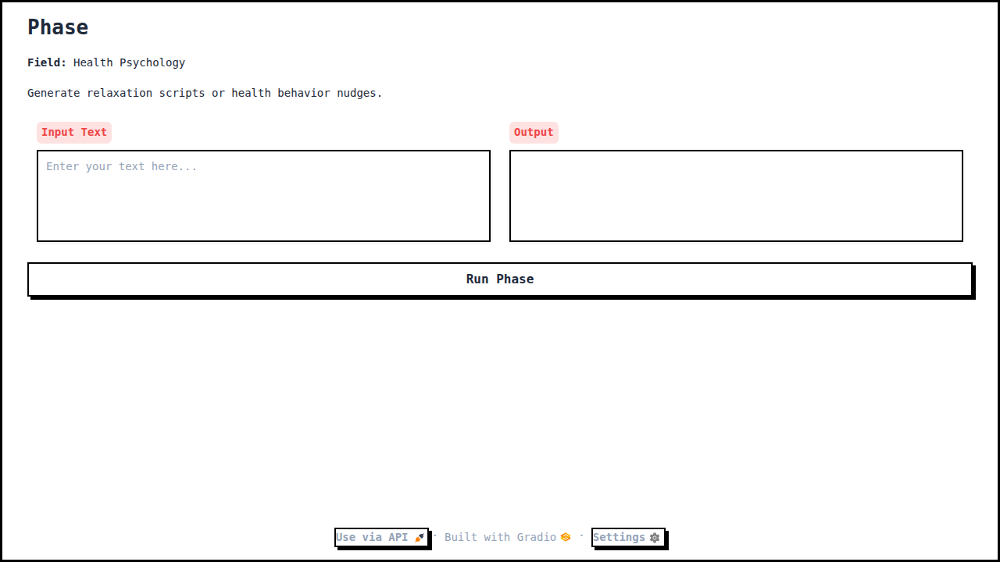

---

## Phase_Streamlit
**Field:** Social Psychology

**File:** `psychology_inference_tools/Phase_Streamlit.py`

---

## Pivot_Gradio
**Field:** Family Psychology

**File:** `psychology_inference_tools/Pivot_Gradio.py`

---

## Pivot_Streamlit
**Field:** Clinical Psychology

**File:** `psychology_inference_tools/Pivot_Streamlit.py`

---

## Prism_Gradio
**Field:** Comparative Psychology

**File:** `psychology_inference_tools/Prism_Gradio.py`

---

## Pulse_Gradio
**Field:** Family Psychology

**File:** `psychology_inference_tools/Pulse_Gradio.py`

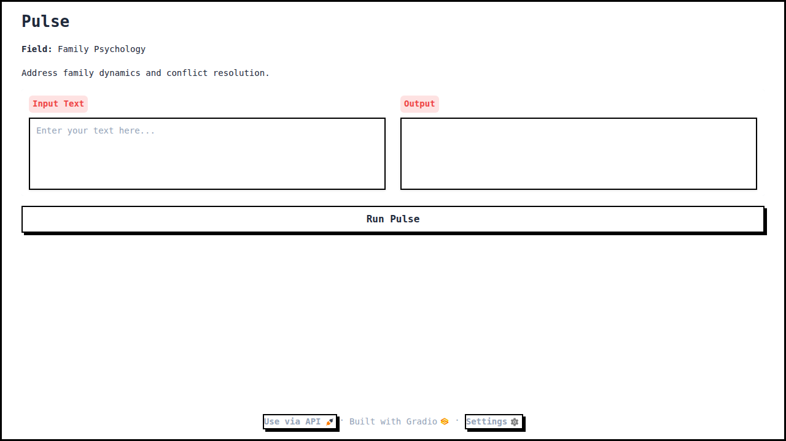

---

## Pulse_Streamlit
**Field:** Environmental Psychology

**File:** `psychology_inference_tools/Pulse_Streamlit.py`

---

## Quest_Streamlit
**Field:** Evolutionary Psychology

**File:** `psychology_inference_tools/Quest_Streamlit.py`

---

## Radius_Gradio
**Field:** Family Psychology

**File:** `psychology_inference_tools/Radius_Gradio.py`

---

## Radius_Streamlit
**Field:** Health Psychology

**File:** `psychology_inference_tools/Radius_Streamlit.py`

---

## Realm_Streamlit
**Field:** Comparative Psychology

**File:** `psychology_inference_tools/Realm_Streamlit.py`

---

## Resonance_Gradio
**Field:** Cross-Cultural Psychology

**File:** `psychology_inference_tools/Resonance_Gradio.py`

---

## Rhythm_Gradio
**Field:** Family Psychology

**File:** `psychology_inference_tools/Rhythm_Gradio.py`

---

## Rhythm_Streamlit
**Field:** Rehabilitation Psychology

**File:** `psychology_inference_tools/Rhythm_Streamlit.py`

---

## Sage_Streamlit
**Field:** Comparative Psychology

**File:** `psychology_inference_tools/Sage_Streamlit.py`

---

## Scale_Streamlit
**Field:** Consumer Psychology

**File:** `psychology_inference_tools/Scale_Streamlit.py`

---

## Scope_Gradio
**Field:** Educational Psychology

**File:** `psychology_inference_tools/Scope_Gradio.py`

---

## Scope_Streamlit
**Field:** Rehabilitation Psychology

**File:** `psychology_inference_tools/Scope_Streamlit.py`

---

## Scribe_Gradio
**Field:** Positive Psychology

**File:** `psychology_inference_tools/Scribe_Gradio.py`

---

## Sense_Streamlit
**Field:** Positive Psychology

**File:** `psychology_inference_tools/Sense_Streamlit.py`

---

## Shift_Streamlit
**Field:** Forensic Psychology

**File:** `psychology_inference_tools/Shift_Streamlit.py`

---

## Signal_Gradio
**Field:** Health Psychology

**File:** `psychology_inference_tools/Signal_Gradio.py`

---

## Signal_Streamlit
**Field:** Sports Psychology

**File:** `psychology_inference_tools/Signal_Streamlit.py`

---

## Sonic_Gradio
**Field:** Educational Psychology

**File:** `psychology_inference_tools/Sonic_Gradio.py`

---

## Sonic_Streamlit
**Field:** Developmental Psychology

**File:** `psychology_inference_tools/Sonic_Streamlit.py`

---

## Spark_Gradio
**Field:** Clinical Psychology

**File:** `psychology_inference_tools/Spark_Gradio.py`

---

## Spark_Streamlit
**Field:** Evolutionary Psychology

**File:** `psychology_inference_tools/Spark_Streamlit.py`

---

## Spectrum_Streamlit
**Field:** Educational Psychology

**File:** `psychology_inference_tools/Spectrum_Streamlit.py`

---

## Sphere_Gradio
**Field:** Evolutionary Psychology

**File:** `psychology_inference_tools/Sphere_Gradio.py`

---

## Sphere_Streamlit
**Field:** Consumer Psychology

**File:** `psychology_inference_tools/Sphere_Streamlit.py`

---

## Spire_Streamlit
**Field:** Evolutionary Psychology

**File:** `psychology_inference_tools/Spire_Streamlit.py`

---

## Spirit_Gradio
**Field:** Cross-Cultural Psychology

**File:** `psychology_inference_tools/Spirit_Gradio.py`

---

## Spirit_Streamlit
**Field:** Industrial-Organizational Psychology

**File:** `psychology_inference_tools/Spirit_Streamlit.py`

---

## Surge_Gradio
**Field:** Clinical Psychology

**File:** `psychology_inference_tools/Surge_Gradio.py`

---

## Sync_Gradio
**Field:** Biopsychology

**File:** `psychology_inference_tools/Sync_Gradio.py`

---

## Sync_Streamlit
**Field:** Forensic Psychology

**File:** `psychology_inference_tools/Sync_Streamlit.py`

---

## Synergy_Gradio
**Field:** Cross-Cultural Psychology

**File:** `psychology_inference_tools/Synergy_Gradio.py`

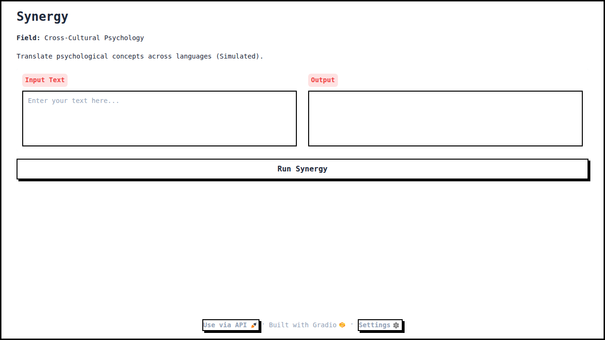

---

## Synergy_Streamlit
**Field:** Comparative Psychology

**File:** `psychology_inference_tools/Synergy_Streamlit.py`

---

## Synthesis_Streamlit
**Field:** Evolutionary Psychology

**File:** `psychology_inference_tools/Synthesis_Streamlit.py`

---

## Tact_Gradio
**Field:** Evolutionary Psychology

**File:** `psychology_inference_tools/Tact_Gradio.py`

---

## Tempo_Gradio
**Field:** Industrial-Organizational Psychology

**File:** `psychology_inference_tools/Tempo_Gradio.py`

---

## Terra_Gradio
**Field:** Developmental Psychology

**File:** `psychology_inference_tools/Terra_Gradio.py`

---

## Terra_Streamlit
**Field:** Health Psychology

**File:** `psychology_inference_tools/Terra_Streamlit.py`

---

## Theta_Gradio
**Field:** Clinical Psychology

**File:** `psychology_inference_tools/Theta_Gradio.py`

---

## Theta_Streamlit
**Field:** Cognitive Psychology

**File:** `psychology_inference_tools/Theta_Streamlit.py`

---

## Tide_Gradio
**Field:** Social Psychology

**File:** `psychology_inference_tools/Tide_Gradio.py`

---

## Tide_Streamlit
**Field:** Social Psychology

**File:** `psychology_inference_tools/Tide_Streamlit.py`

---

## Tonic_Gradio
**Field:** Environmental Psychology

**File:** `psychology_inference_tools/Tonic_Gradio.py`

---

## Tonic_Streamlit
**Field:** Social Psychology

**File:** `psychology_inference_tools/Tonic_Streamlit.py`

---

## Trace_Gradio
**Field:** Developmental Psychology

**File:** `psychology_inference_tools/Trace_Gradio.py`

---

## Trace_Streamlit
**Field:** Forensic Psychology

**File:** `psychology_inference_tools/Trace_Streamlit.py`

---

## Track_Gradio
**Field:** Social Psychology

**File:** `psychology_inference_tools/Track_Gradio.py`

---

## Track_Streamlit
**Field:** Educational Psychology

**File:** `psychology_inference_tools/Track_Streamlit.py`

---

## Transcend_Streamlit
**Field:** Health Psychology

**File:** `psychology_inference_tools/Transcend_Streamlit.py`

---

## Unity_Gradio
**Field:** Family Psychology

**File:** `psychology_inference_tools/Unity_Gradio.py`

---

## Unity_Streamlit
**Field:** Psychometrics

**File:** `psychology_inference_tools/Unity_Streamlit.py`

---

## Valence_Streamlit
**Field:** Developmental Psychology

**File:** `psychology_inference_tools/Valence_Streamlit.py`

---

## Vector_Gradio
**Field:** Cross-Cultural Psychology

**File:** `psychology_inference_tools/Vector_Gradio.py`

---

## Velocity_Gradio
**Field:** Positive Psychology

**File:** `psychology_inference_tools/Velocity_Gradio.py`

---

## Velocity_Streamlit
**Field:** Health Psychology

**File:** `psychology_inference_tools/Velocity_Streamlit.py`

---

## Verve_Gradio
**Field:** Developmental Psychology

**File:** `psychology_inference_tools/Verve_Gradio.py`

---

## Verve_Streamlit
**Field:** Rehabilitation Psychology

**File:** `psychology_inference_tools/Verve_Streamlit.py`

---

## Vigil_Streamlit
**Field:** Industrial-Organizational Psychology

**File:** `psychology_inference_tools/Vigil_Streamlit.py`

---

## Vision_Gradio
**Field:** Sports Psychology

**File:** `psychology_inference_tools/Vision_Gradio.py`

---

## Vision_Streamlit
**Field:** Evolutionary Psychology

**File:** `psychology_inference_tools/Vision_Streamlit.py`

---

## Vivid_Gradio
**Field:** Consumer Psychology

**File:** `psychology_inference_tools/Vivid_Gradio.py`

---

## Vortex_Gradio
**Field:** Cross-Cultural Psychology

**File:** `psychology_inference_tools/Vortex_Gradio.py`

---

## Warden_Gradio
**Field:** Neuropsychology

**File:** `psychology_inference_tools/Warden_Gradio.py`

---

## Wave_Streamlit
**Field:** Social Psychology

**File:** `psychology_inference_tools/Wave_Streamlit.py`

---

## Weave_Gradio
**Field:** Sports Psychology

**File:** `psychology_inference_tools/Weave_Gradio.py`

---

## Weave_Streamlit
**Field:** Educational Psychology

**File:** `psychology_inference_tools/Weave_Streamlit.py`

---

## Will_Gradio
**Field:** Health Psychology

**File:** `psychology_inference_tools/Will_Gradio.py`

---

## Will_Streamlit
**Field:** Family Psychology

**File:** `psychology_inference_tools/Will_Streamlit.py`

---

## Xenon_Streamlit
**Field:** Psychometrics

**File:** `psychology_inference_tools/Xenon_Streamlit.py`

---

## Yonder_Gradio
**Field:** Family Psychology

**File:** `psychology_inference_tools/Yonder_Gradio.py`

---

## Yonder_Streamlit
**Field:** Comparative Psychology

**File:** `psychology_inference_tools/Yonder_Streamlit.py`

---

## Zenith_Streamlit
**Field:** Evolutionary Psychology

**File:** `psychology_inference_tools/Zenith_Streamlit.py`

---

## Zephyr_Gradio
**Field:** Developmental Psychology

**File:** `psychology_inference_tools/Zephyr_Gradio.py`

---

## Zephyr_Streamlit
**Field:** Psychometrics

**File:** `psychology_inference_tools/Zephyr_Streamlit.py`

---

## Zeta_Streamlit
**Field:** Environmental Psychology

**File:** `psychology_inference_tools/Zeta_Streamlit.py`

---

## Zone_Gradio
**Field:** Positive Psychology

**File:** `psychology_inference_tools/Zone_Gradio.py`

---

## Zone_Streamlit
**Field:** Developmental Psychology

**File:** `psychology_inference_tools/Zone_Streamlit.py`

---
