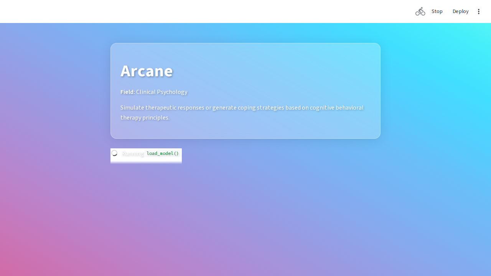
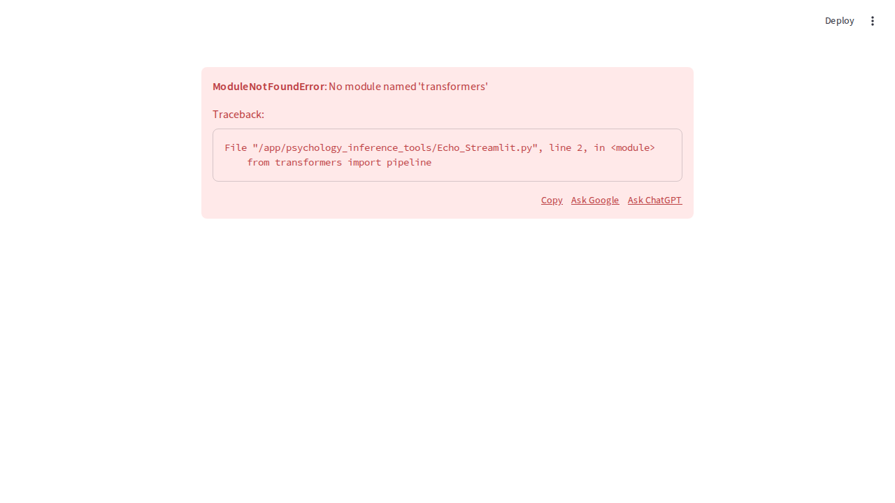
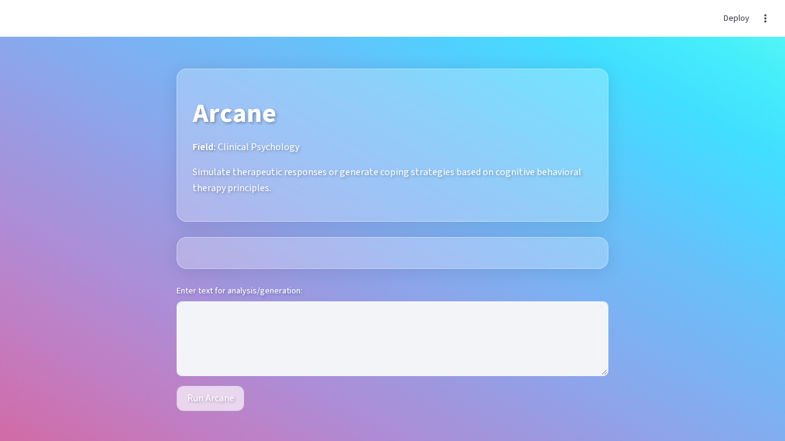
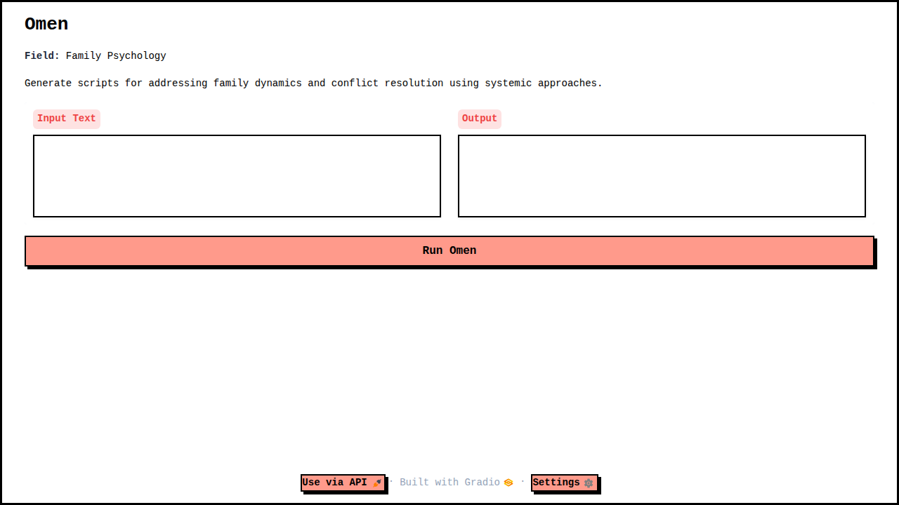

# Psychology Inference Tools User Manual

## Introduction
This manual provides a comprehensive guide to the AI-powered psychology inference tools generated in this repository. Each tool is designed for a specific domain within psychology, leveraging state-of-the-art NLP models to assist researchers, students, and practitioners.

## General Usage
- **Streamlit Tools:** Run with `streamlit run <tool_name>.py`. Access at `http://localhost:8501`.
- **Gradio Tools:** Run with `python <tool_name>.py`. Access at `http://localhost:7860`.

---

# Tools Catalog

## Aether_Streamlit
**Field:** Positive Psychology

**File:** `psychology_inference_tools/Aether_Streamlit.py`

---

## Alpha_Streamlit
**Field:** Positive Psychology

**File:** `psychology_inference_tools/Alpha_Streamlit.py`

---

## Apex_Streamlit
**Field:** Sports Psychology

**File:** `psychology_inference_tools/Apex_Streamlit.py`

---

## Arcane_Streamlit
**Field:** Clinical Psychology

**File:** `psychology_inference_tools/Arcane_Streamlit.py`

---

## Aura_Gradio
**Field:** Forensic Psychology

**File:** `psychology_inference_tools/Aura_Gradio.py`

---

## Axis_Streamlit
**Field:** Health Psychology

**File:** `psychology_inference_tools/Axis_Streamlit.py`

---

## Beacon_Streamlit
**Field:** Educational Psychology

**File:** `psychology_inference_tools/Beacon_Streamlit.py`

---

## Beta_Streamlit
**Field:** Environmental Psychology

**File:** `psychology_inference_tools/Beta_Streamlit.py`

---

## Clarity_Streamlit
**Field:** Clinical Psychology

**File:** `psychology_inference_tools/Clarity_Streamlit.py`

---

## Coral_Gradio
**Field:** Sports Psychology

**File:** `psychology_inference_tools/Coral_Gradio.py`

---

## Crisp_Gradio
**Field:** Biopsychology

**File:** `psychology_inference_tools/Crisp_Gradio.py`

---

## Delta_Gradio
**Field:** Sleep Psychology

**File:** `psychology_inference_tools/Delta_Gradio.py`

---

## Drive_Streamlit
**Field:** Family Psychology

**File:** `psychology_inference_tools/Drive_Streamlit.py`

---

## Dusk_Streamlit
**Field:** Sports Psychology

**File:** `psychology_inference_tools/Dusk_Streamlit.py`

---

## Echo_Streamlit
**Field:** Industrial-Organizational Psychology

**File:** `psychology_inference_tools/Echo_Streamlit.py`

---

## Elan_Gradio
**Field:** Sleep Psychology

**File:** `psychology_inference_tools/Elan_Gradio.py`

---

## Ember_Gradio
**Field:** Consumer Psychology

**File:** `psychology_inference_tools/Ember_Gradio.py`

---

## Epsilon_Streamlit
**Field:** Cognitive Psychology

**File:** `psychology_inference_tools/Epsilon_Streamlit.py`

---

## Essence_Streamlit
**Field:** Social Psychology (Sentiment)

**File:** `psychology_inference_tools/Essence_Streamlit.py`

---

## Eta_Streamlit
**Field:** Comparative Psychology

**File:** `psychology_inference_tools/Eta_Streamlit.py`

---

## Ethos_Gradio
**Field:** Biopsychology

**File:** `psychology_inference_tools/Ethos_Gradio.py`

---

## Fern_Gradio
**Field:** Industrial-Organizational Psychology

**File:** `psychology_inference_tools/Fern_Gradio.py`

---

## Focus_Streamlit
**Field:** Crisis Intervention

**File:** `psychology_inference_tools/Focus_Streamlit.py`

---

## Forge_Streamlit
**Field:** Neuropsychology

**File:** `psychology_inference_tools/Forge_Streamlit.py`

---

## Gamma_Streamlit
**Field:** Educational Psychology

**File:** `psychology_inference_tools/Gamma_Streamlit.py`

---

## Garnet_Streamlit
**Field:** Rehabilitation Psychology

**File:** `psychology_inference_tools/Garnet_Streamlit.py`

---

## Gaze_Gradio
**Field:** Media Psychology

**File:** `psychology_inference_tools/Gaze_Gradio.py`

---

## Glint_Streamlit
**Field:** Positive Psychology

**File:** `psychology_inference_tools/Glint_Streamlit.py`

---

## Grace_Gradio
**Field:** Industrial-Organizational Psychology

**File:** `psychology_inference_tools/Grace_Gradio.py`

---

## Halo_Streamlit
**Field:** Sleep Psychology

**File:** `psychology_inference_tools/Halo_Streamlit.py`

---

## Haptic_Streamlit
**Field:** Social Psychology (Emotion)

**File:** `psychology_inference_tools/Haptic_Streamlit.py`

---

## Helm_Streamlit
**Field:** Social Psychology (Sentiment)

**File:** `psychology_inference_tools/Helm_Streamlit.py`

---

## Hush_Streamlit
**Field:** Media Psychology

**File:** `psychology_inference_tools/Hush_Streamlit.py`

---

## Icon_Gradio
**Field:** Consumer Psychology

**File:** `psychology_inference_tools/Icon_Gradio.py`

---

## Ionic_Streamlit
**Field:** Social Psychology (Emotion)

**File:** `psychology_inference_tools/Ionic_Streamlit.py`

---

## Iota_Streamlit
**Field:** Psychometrics

**File:** `psychology_inference_tools/Iota_Streamlit.py`

---

## Iris_Streamlit
**Field:** Evolutionary Psychology

**File:** `psychology_inference_tools/Iris_Streamlit.py`

---

## Ivory_Streamlit
**Field:** Social Psychology (Emotion)

**File:** `psychology_inference_tools/Ivory_Streamlit.py`

---

## Jade_Streamlit
**Field:** Cross-Cultural Psychology

**File:** `psychology_inference_tools/Jade_Streamlit.py`

---

## Joy_Streamlit
**Field:** Crisis Intervention

**File:** `psychology_inference_tools/Joy_Streamlit.py`

---

## Kairos_Streamlit
**Field:** Evolutionary Psychology

**File:** `psychology_inference_tools/Kairos_Streamlit.py`

---

## Keen_Streamlit
**Field:** Family Psychology

**File:** `psychology_inference_tools/Keen_Streamlit.py`

---

## Kinetic_Gradio
**Field:** Family Psychology

**File:** `psychology_inference_tools/Kinetic_Gradio.py`

---

## Knack_Streamlit
**Field:** Biopsychology

**File:** `psychology_inference_tools/Knack_Streamlit.py`

---

## Lambda_Streamlit
**Field:** Rehabilitation Psychology

**File:** `psychology_inference_tools/Lambda_Streamlit.py`

---

## Lens_Gradio
**Field:** Industrial-Organizational Psychology

**File:** `psychology_inference_tools/Lens_Gradio.py`

---

## Lime_Streamlit
**Field:** Rehabilitation Psychology

**File:** `psychology_inference_tools/Lime_Streamlit.py`

---

## Logic_Gradio
**Field:** Environmental Psychology

**File:** `psychology_inference_tools/Logic_Gradio.py`

---

## Lotus_Streamlit
**Field:** Cognitive Psychology

**File:** `psychology_inference_tools/Lotus_Streamlit.py`

---

## Matrix_Streamlit
**Field:** Media Psychology

**File:** `psychology_inference_tools/Matrix_Streamlit.py`

---

## Mind_Streamlit
**Field:** Evolutionary Psychology

**File:** `psychology_inference_tools/Mind_Streamlit.py`

---

## Mode_Gradio
**Field:** Cyberpsychology

**File:** `psychology_inference_tools/Mode_Gradio.py`

---

## Momentum_Streamlit
**Field:** Cyberpsychology

**File:** `psychology_inference_tools/Momentum_Streamlit.py`

---

## Mosaic_Gradio
**Field:** Developmental Psychology

**File:** `psychology_inference_tools/Mosaic_Gradio.py`

---

## Moss_Streamlit
**Field:** Comparative Psychology

**File:** `psychology_inference_tools/Moss_Streamlit.py`

---

## Mu_Gradio
**Field:** Health Psychology

**File:** `psychology_inference_tools/Mu_Gradio.py`

---

## Neon_Gradio
**Field:** Comparative Psychology

**File:** `psychology_inference_tools/Neon_Gradio.py`

---

## Omen_Gradio
**Field:** Family Psychology

**File:** `psychology_inference_tools/Omen_Gradio.py`

---

## Optic_Gradio
**Field:** Psychometrics

**File:** `psychology_inference_tools/Optic_Gradio.py`

---

## Oracle_Gradio
**Field:** Rehabilitation Psychology

**File:** `psychology_inference_tools/Oracle_Gradio.py`

---

## Origin_Gradio
**Field:** Developmental Psychology

**File:** `psychology_inference_tools/Origin_Gradio.py`

---

## Pace_Streamlit
**Field:** Health Psychology

**File:** `psychology_inference_tools/Pace_Streamlit.py`

---

## Path_Gradio
**Field:** Forensic Psychology

**File:** `psychology_inference_tools/Path_Gradio.py`

---

## Peak_Streamlit
**Field:** Psychometrics

**File:** `psychology_inference_tools/Peak_Streamlit.py`

---

## Pure_Gradio
**Field:** Developmental Psychology

**File:** `psychology_inference_tools/Pure_Gradio.py`

---

## Quartz_Streamlit
**Field:** Neuropsychology

**File:** `psychology_inference_tools/Quartz_Streamlit.py`

---

## Quiet_Streamlit
**Field:** Neuropsychology

**File:** `psychology_inference_tools/Quiet_Streamlit.py`

---

## Radius_Gradio
**Field:** Media Psychology

**File:** `psychology_inference_tools/Radius_Gradio.py`

---

## Rave_Streamlit
**Field:** Sports Psychology

**File:** `psychology_inference_tools/Rave_Streamlit.py`

---

## Realm_Gradio
**Field:** Cognitive Psychology

**File:** `psychology_inference_tools/Realm_Gradio.py`

---

## Rhythm_Streamlit
**Field:** Geropsychology

**File:** `psychology_inference_tools/Rhythm_Streamlit.py`

---

## Ripple_Streamlit
**Field:** Social Psychology (Sentiment)

**File:** `psychology_inference_tools/Ripple_Streamlit.py`

---

## Root_Gradio
**Field:** Geropsychology

**File:** `psychology_inference_tools/Root_Gradio.py`

---

## Rose_Streamlit
**Field:** Forensic Psychology

**File:** `psychology_inference_tools/Rose_Streamlit.py`

---

## Ruby_Gradio
**Field:** Social Psychology (Emotion)

**File:** `psychology_inference_tools/Ruby_Gradio.py`

---

## Sage_Gradio
**Field:** Educational Psychology

**File:** `psychology_inference_tools/Sage_Gradio.py`

---

## Scope_Gradio
**Field:** Sleep Psychology

**File:** `psychology_inference_tools/Scope_Gradio.py`

---

## Sense_Gradio
**Field:** Cross-Cultural Psychology

**File:** `psychology_inference_tools/Sense_Gradio.py`

---

## Sonic_Streamlit
**Field:** Geropsychology

**File:** `psychology_inference_tools/Sonic_Streamlit.py`

---

## Soul_Gradio
**Field:** Social Psychology (Sentiment)

**File:** `psychology_inference_tools/Soul_Gradio.py`

---

## Spark_Gradio
**Field:** Cognitive Psychology

**File:** `psychology_inference_tools/Spark_Gradio.py`

---

## Spectrum_Gradio
**Field:** Educational Psychology

**File:** `psychology_inference_tools/Spectrum_Gradio.py`

---

## Sphere_Gradio
**Field:** Crisis Intervention

**File:** `psychology_inference_tools/Sphere_Gradio.py`

---

## Spirit_Streamlit
**Field:** Consumer Psychology

**File:** `psychology_inference_tools/Spirit_Streamlit.py`

---

## Surge_Gradio
**Field:** Cyberpsychology

**File:** `psychology_inference_tools/Surge_Gradio.py`

---

## Sync_Streamlit
**Field:** Social Psychology (Sentiment)

**File:** `psychology_inference_tools/Sync_Streamlit.py`

---

## Synergy_Gradio
**Field:** Biopsychology

**File:** `psychology_inference_tools/Synergy_Gradio.py`

---

## Synthesis_Gradio
**Field:** Cyberpsychology

**File:** `psychology_inference_tools/Synthesis_Gradio.py`

---

## Tempo_Streamlit
**Field:** Cognitive Psychology

**File:** `psychology_inference_tools/Tempo_Streamlit.py`

---

## Terra_Gradio
**Field:** Positive Psychology

**File:** `psychology_inference_tools/Terra_Gradio.py`

---

## Tide_Streamlit
**Field:** Clinical Psychology

**File:** `psychology_inference_tools/Tide_Streamlit.py`

---

## Topaz_Streamlit
**Field:** Environmental Psychology

**File:** `psychology_inference_tools/Topaz_Streamlit.py`

---

## Trace_Gradio
**Field:** Developmental Psychology

**File:** `psychology_inference_tools/Trace_Gradio.py`

---

## Umbra_Streamlit
**Field:** Forensic Psychology

**File:** `psychology_inference_tools/Umbra_Streamlit.py`

---

## Vale_Gradio
**Field:** Comparative Psychology

**File:** `psychology_inference_tools/Vale_Gradio.py`

---

## Valence_Gradio
**Field:** Social Psychology (Emotion)

**File:** `psychology_inference_tools/Valence_Gradio.py`

---

## Vector_Streamlit
**Field:** Environmental Psychology

**File:** `psychology_inference_tools/Vector_Streamlit.py`

---

## Vigil_Gradio
**Field:** Consumer Psychology

**File:** `psychology_inference_tools/Vigil_Gradio.py`

---

## Violet_Gradio
**Field:** Neuropsychology

**File:** `psychology_inference_tools/Violet_Gradio.py`

---

## Vision_Streamlit
**Field:** Crisis Intervention

**File:** `psychology_inference_tools/Vision_Streamlit.py`

---

## Vital_Gradio
**Field:** Industrial-Organizational Psychology

**File:** `psychology_inference_tools/Vital_Gradio.py`

---

## Vivid_Gradio
**Field:** Health Psychology

**File:** `psychology_inference_tools/Vivid_Gradio.py`

---

## Warden_Streamlit
**Field:** Geropsychology

**File:** `psychology_inference_tools/Warden_Streamlit.py`

---

## Will_Streamlit
**Field:** Clinical Psychology

**File:** `psychology_inference_tools/Will_Streamlit.py`

---

## Yonder_Gradio
**Field:** Psychometrics

**File:** `psychology_inference_tools/Yonder_Gradio.py`

---

## Yore_Streamlit
**Field:** Clinical Psychology

**File:** `psychology_inference_tools/Yore_Streamlit.py`

---

## Zenith_Gradio
**Field:** Cross-Cultural Psychology

**File:** `psychology_inference_tools/Zenith_Gradio.py`

---

## Zephyr_Streamlit
**Field:** Cross-Cultural Psychology

**File:** `psychology_inference_tools/Zephyr_Streamlit.py`

---

## Zeta_Gradio
**Field:** Developmental Psychology

**File:** `psychology_inference_tools/Zeta_Gradio.py`

---

## Zone_Streamlit
**Field:** Evolutionary Psychology

**File:** `psychology_inference_tools/Zone_Streamlit.py`

---
